# COHI-Player-Universal

**Version 1.1.1** · License: [GPL-3.0](LICENSE)

Original author: Claus Peter Gallenmiller (v1.0.0, [CPG-Archive/COHI-Player-Universal](https://github.com/CPG-Archive/COHI-Player-Universal)).
Extensions by radiolab81:
- **v1.1.0** (10.11.2026): output to smiSDR / parlioSDR with variable DAC widths of 8 to 14 bit
- **v1.1.1** (11.11.2026): remote control of the station field strength and sferics / lightning simulation (AMWaveSynth protocol), coupling to the AMWaveSynthPropagationSimulator

COHI-Player turns a Raspberry Pi or PC into a small "broadcast station" for vintage radios. It replays recordings of complete AM broadcast bands and/or current internet radio streams on several freely selectable carrier frequencies at the same time, so that an old receiver can be tuned across the dial just like in its day. 

COHI-Player is part of the COHIRADIA project. Detailed information for installation, hardware setup and an archive with many recordings from 2006 on can be found on [COHIRADIA](https://www.cohiradia.org/).

The radio frequency signal is generated either by an **STEMlab / Red Pitaya** board, by an inexpensive **FL2K USB-to-VGA dongle** (osmo-fl2k) or by a **smiSDR / parlioSDR** (radiolab81) that is fed with RF samples via the network.

The COHI-Player-Universal does not need any manual interaction for loading or starting the playback of a spectrum file. It starts automatically to play all spectrum wav files stored on an USB stick or any internal directory. Thus, it is an ideal source to simulate antenna signals for historic radio receivers in large collections or museums.

> **Important – please read before use:** The output of this software is a real RF signal in the medium wave band. Transmitting on these frequencies without a licence is illegal in most countries and can disturb other services. Connect the output to the receiver **by cable** and insulating transformer (please carefully read these [instructions](https://www.cohiradia.org/de/docs/getting_started/koppelgeraet/)) to the antenna input or use a coupling loop with negligible radiation. You are responsible for operating the setup in compliance with your local regulations.

---

## 1. Overview

| Program | Purpose |
|---|---|
| **COHI-Player** | Replays SDR band recordings (I/Q WAV files) – e.g. historical recordings of the complete medium wave band |
| **COHI-Stream** | Feeds current internet radio streams (MP3/AAC/M3U) as AM carriers on user-defined frequencies |
| **COHI-Player+Stream** | Both at once: a band recording plus additional live stream carriers |


With COHI-Stream and COHI-Player+Stream the band can also be made **alive**: the field strength of every station, and even thunderstorm crackle, can be controlled in real time by a propagation simulator, so that band openings at dusk, fading skywave stations and thunderstorms are heard on the vintage radio (see 2.5).

The three player modes share one program (`cohi_player_main.py`); the mode is selected in `config_sdr.yaml` (`program_variant`). 

The user interface is available in **English** and **German** (`language` in `config_sdr.yaml`).

---

## 2. Program modes

### 2.1 COHI-Player

Replays I/Q WAV recordings in the SDR formats "auxi" (SDRuno, including chained files) and "rcvr". Several recording directories can be configured; the player steps through all recordings found there.

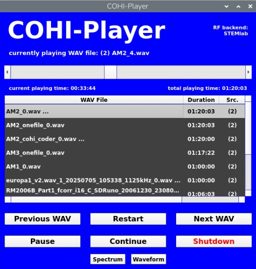

> **File naming – important:** COHI-Player only finds recordings whose file name ends with **`_0.wav`** (e.g. `MW_Berlin_1936_0.wav`). All other WAV files are ignored.
>
> - The configured directories are searched **including all subdirectories**; the recordings are played in alphabetical order.
> - On Linux the ending is case-sensitive: `_0.WAV` is **not** found.
> - Long recordings that are split into several files (`…_1.wav`, `…_2.wav`, …) are usually linked via the "nextfilename" entry in the WAV header in case the files have standard wav headers as required for COHIRADIA. Only the first file (`_0.wav`) is listed; the following parts are played automatically.

### 2.2 COHI-Stream

Plays a list of internet radio stations simultaneously, each on its own carrier frequency and with its own audio bandwidth. The station list can be edited directly in the program.

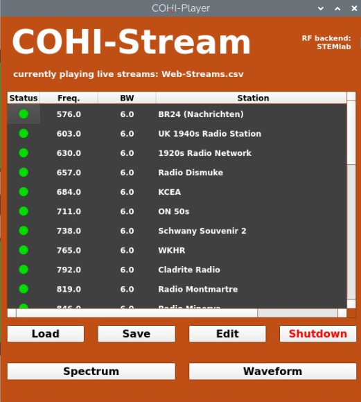

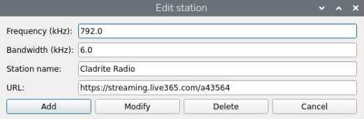

### 2.3 COHI-Player+Stream

Combines both: a band recording plus live stream carriers. On the small 3.5" display (480×320) the two halves of the window are switched with the arrow buttons (▶ / ◀) in the status line.

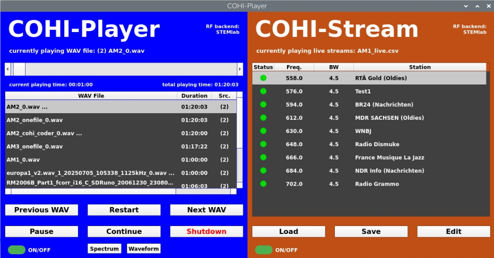

### 2.4 Which mode works with which output hardware

| Output (`hwconfig`) | Upconverter (`fl2k_upconverter`) | COHI-Player | COHI-Stream | COHI-Player+Stream |
|---|---|:-:|:-:|:-:|
| `stemlab` | – | ✔ | ✔ | ✔ |
| `fl2k` | `cpp` (compiled C++ tool, recommended) | ✔ | ✔ | ✔ |
| `fl2k` | `native` (Python/NumPy) | ✔ | – | – |
| `fl2k` | `ffmpeg` | ✔ | – | – |
| `smisdr` | – (always the compiled C++ tool) | ✔ | ✔ | ✔ |

### 2.5 Realistic propagation: band openings, skywave and thunderstorms

COHI-Stream (and the live stations of COHI-Player+Stream) can be coupled to the **[AMWaveSynthPropagationSimulator](https://github.com/radiolab81/AMWaveSynthPropagationSimulator)**. The simulator knows where each station is transmitted from, where your receiver stands, and calculates for the chosen date and time of day the field strength with ground wave and skywave. It sends the result over the network to COHI-Player, which sets the level of every station accordingly (protocol and settings: 5.6). The simulator can also place thunderstorm cells on the map; they are heard as crackling lightning (sferics) on all stations.

What you get:

- **Daytime:** only the nearby stations are received by ground wave (`GrW`); the band is almost empty.
- **Dusk and night:** the D layer vanishes, the band opens and many distant stations arrive by skywave (`SkW`). Fast-forwarding through a day lets you hear this like a real evening on the dial.
- **Receiver location:** the same station list sounds different in southern Germany and in the Netherlands, because different transmitters are near.
- **Thunderstorms:** a storm cell moving across the map causes crackling bursts, visible as horizontal stripes in the waterfall.

| Receiver in southern Germany, 12:03 UTC | Receiver in southern Germany, 22:46 UTC |
|---|---|
| 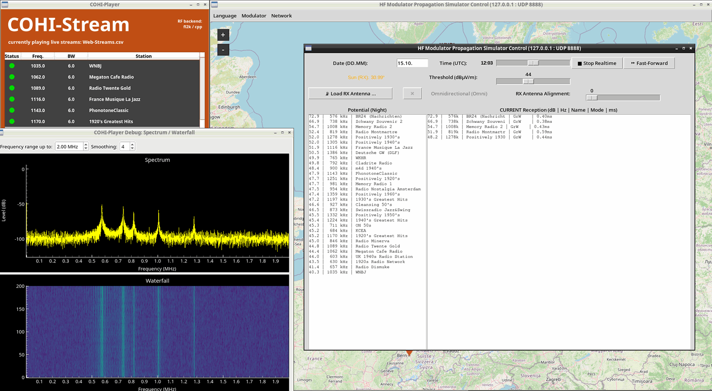 | 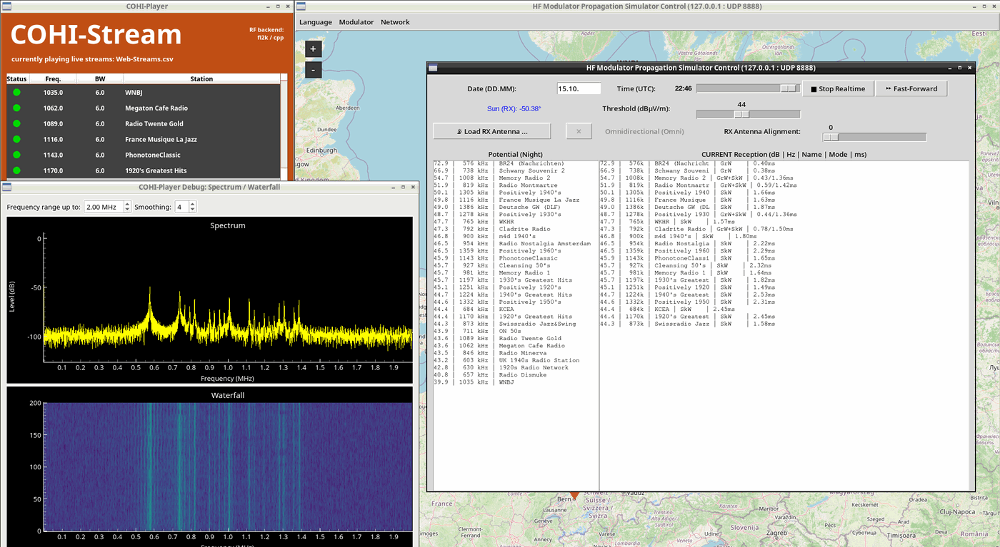 |

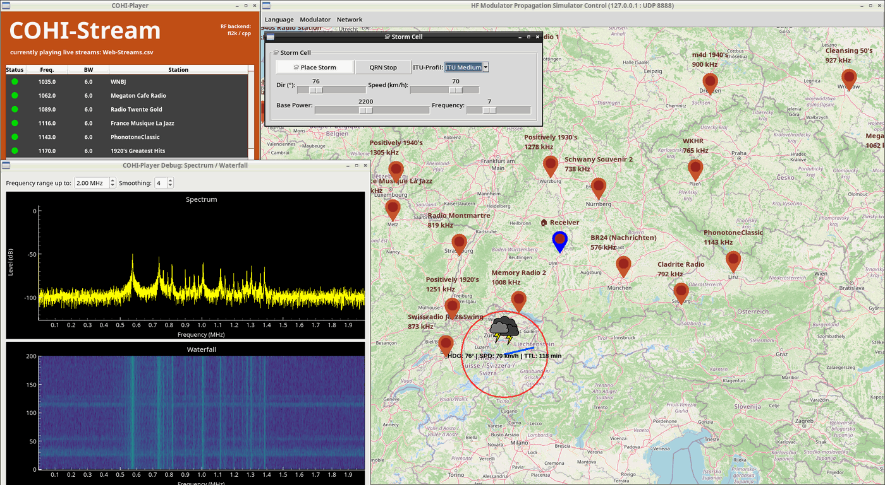

| Station map (receiver in southern Germany) | Receiver in the Netherlands |
|---|---|
| 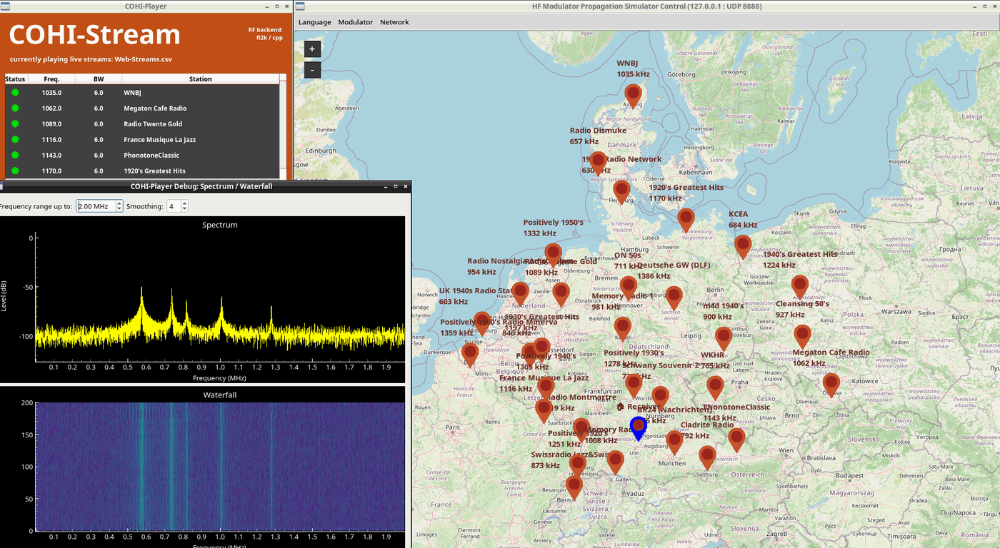 | 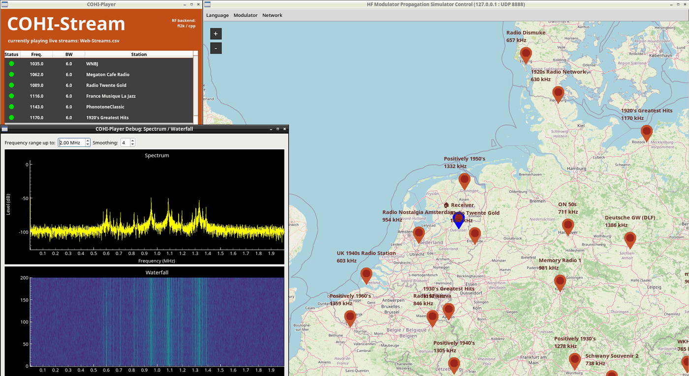 |

**Direction-finder scope:** the [DFscope plugin](https://github.com/radiolab81/AMWaveSynthPropagationSimulator/tree/main/plugins/DFscope) of the simulator turns the receiver into a rotating loop antenna (figure-eight pattern, shown around the receiver on the map). The field strength of each station is weighted by its direction, so the stations nearly in line with the lobes get loud, while a station in the null fades away. In the first picture the lobes point towards Groningen (1332 kHz) and Hannover (711 kHz), which dominate the spectrum; in the second the loop has been turned towards Enschede, and Radio Twente Gold (1089 kHz) takes over while 711 and 1332 kHz almost disappear. Just like with a real loop antenna on a vintage radio.

| Loop towards Groningen / Hannover | Loop turned towards Enschede |
|---|---|
|  | 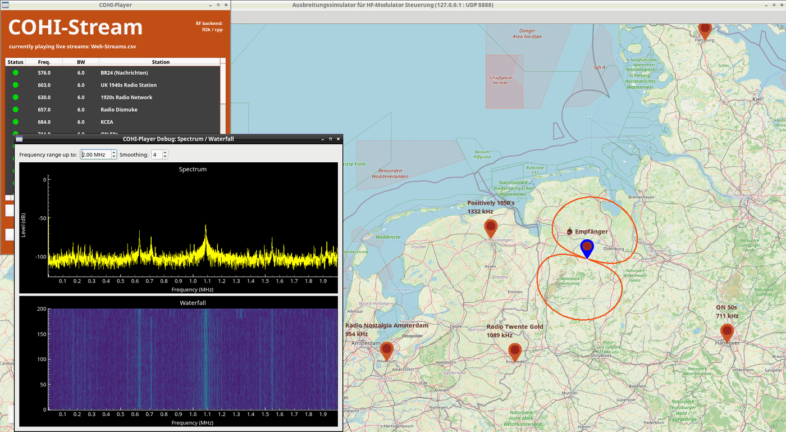 |

**Setup in short**

1. Set `program_variant: COHI-Stream` (or `COHI-Player+Stream`), keep `live_control_port: 8888` and `live_sferics_port: 8889` in `config_sdr.yaml`, start COHI-Player.
2. Start the AMWaveSynthPropagationSimulator and let it send to the IP address of the COHI-Player computer, UDP port 8888 (and 8889 for lightning).
3. Load the transmitter locations. The example file [`sources/Web-Streams-Locations.csv`](sources/Web-Streams-Locations.csv) fits the example station list `Web-Streams.csv`: it assigns each station a transmitter location, a frequency in kHz and a transmitter power in kW (columns: location, country, frequency, power, programme name). Frequencies must match the station list. The locations are fictitious test transmitter sites for the simulation, not the real locations of these internet streams.
4. Set the receiver location on the map. That's it - move the time slider or let it run in real time.

---

## 3. Requirements

### 3.1 Hardware

- **Raspberry Pi 4** (recommended for COHI-Player) or **Raspberry Pi 5** (recommended for COHI-Player+Stream; it also runs on a Pi 4)
- Display: 3.5" touch display with 480×320 pixels (`display_variant: 1`) or 7" and larger (`display_variant: 2`)
- RF output, one of:
  - **STEMlab 125-14 / Red Pitaya** with the COHI STEMlab firmware image (see 4.4), connected via Ethernet
  - **FL2K USB-to-VGA dongle** (chip FL2000), used with osmo-fl2k
  - **smiSDR / parlioSDR** ([smisdr](https://github.com/radiolab81/smisdr) / [parliosdr](https://github.com/radiolab81/parliosdr)), connected via Ethernet (see 5.5)
- Internet connection (only for COHI-Stream / COHI-Player+Stream). It is stronly recommended to use a wired LAN connection to avoid dropouts in the sound signal.

### 3.2 Operating systems

| | Raspberry Pi OS / Linux | Windows |
|---|:-:|:-:|
| COHI-Player with STEMlab | ✔ | ✔ |
| COHI-Player with FL2K (`ffmpeg` or `native`) | ✔ | ✔ |
| COHI-Player with FL2K (`cpp`) | ✔ | – |
| COHI-Player with smiSDR / parlioSDR | ✔ | ✔ |
| COHI-Stream, COHI-Player+Stream | ✔ | – |
| Configuration tools | ✔ | ✔ |

The live stream modes need the compiled C++ tools; a Windows build of these tools is not provided.

### 3.3 Performance depending on Raspberry Pi HW

| Program variant | Raspberry Pi 4 | Raspberry Pi 5 |
|---|:-:|:-:|
| COHI-Player with STEMlab | ✔ | ✔ |
| COHI-Player with FL2K (`ffmpeg` or `native`) | not possible | ✔ |
| COHI-Player with FL2K (`cpp`) | ✔ | ✔ |
| COHI-Stream with STEMlab | < 25 live streams | > 50 live streams |
| COHI-Stream with FL2K (only `cpp`) | < 14 live streamns | > 40 live streams |
| COHI-Player+Stream with STEMlab | WAV + < 25 live streams | WAV + > 50 live streams |
| COHI-Player+Stream with FL2K (only `cpp`) | not possible | WAV + > 40 live streams |

The number of possible carriers in the above table are only estimations, the real achievable capacity may vary on stream data rate and stability and Raspberry Pi memory size. Performance on PC based Linux installations depends heavily on installed CPU. 

---

## 4. Installation

There are preconfigured plug&play-ready images availble for Raspberry Pi 4 and Raspberry Pi 5 at the [COHIRADIA webpage]([https://www.cohiradia.org/](https://www.cohiradia.org/de/docs/getting_started/installation/)). These images can be simply copied to a SD card to get a fully working COHIRADIA system.

If you are an expert, then you can configure your own system from scratch. In that case please follow the instructions below:

### 4.1 Raspberry Pi OS

Download the release (or clone the repository) into a directory of your choice, e.g. `~/cohi-player`, and change into it.

System packages:

```bash
sudo apt update
sudo apt install python3-pyqt5 qttranslations5-l10n ffmpeg build-essential
```

- `qttranslations5-l10n` is only needed for German standard buttons (Yes/No, file dialogs).

Python packages:

```bash
pip install -r requirements.txt --break-system-packages
```

Optional, only for the debug windows (spectrum/waterfall and waveform, `display_variant: 2`):

```bash
pip install pyqtgraph --break-system-packages
```

### 4.2 Compiling the C++ tools

The C++ tools are required for COHI-Stream, COHI-Player+Stream and the FL2K upconverter `cpp`:

```bash
make
```

> **Always compile on the target device.** The tools are optimised for the CPU they are built on (`-march=native`). A binary compiled on a Raspberry Pi 5 crashes silently on a Raspberry Pi 4. If you move the installation to another Pi model, run `make clean && make` there.

### 4.3 Installation of osmo-fl2k drivers

For the correct function of the **FL2K USB-to-VGA dongle** (osmo-fl2k) the correct installation of its driver is essential. Detailed information can be found in the [osmo-fl2k wiki](https://osmocom.org/projects/osmo-fl2k/wiki). 

Step 1: Open a terminal and install the required build tools and libusb headers: 
```bash
sudo apt update
sudo apt install libusb-1.0-0-dev cmake git make gcc -y
```
Step 2: Clone the source code from the official Osmocom Gitea repository into a dedicated directory, e.g. ~/home/YOURUSERNAME/osmotools and build it: 
```bash
git clone https://gitea.osmocom.org/sdr/osmo-fl2k
mkdir osmo-fl2k/build
cd osmo-fl2k/build
cmake ../ -DINSTALL_UDEV_RULES=ON
make -j$(nproc)
sudo make install
sudo ldconfig
```
Step 3: Reload Udev Rules to allow non-root users to access the device:
```bash
sudo udevadm control -R
sudo udevadm trigger
```

### 4.4 Windows

1. Install Python 3 from [python.org](https://www.python.org/) and run `pip install -r requirements.txt` in the program directory.
2. **For FL2K:** install the FL2K driver and the Windows build of osmo-fl2k (`fl2k_file.exe`), and download a Windows build of ffmpeg. Enter both paths in `config_sdr.yaml` (`fl2k_path`, `ffmpeg_path`).
3. Set `fl2k_upconverter` to `ffmpeg` or `native` (the `cpp` tool is not available on Windows).

Note: with `shutdown: true` in `config_sdr.yaml` the program also shuts down the **Windows PC** when it is closed via the shutdown button.

### 4.5 Preparing the STEMlab / Red Pitaya

The STEMlab needs a special firmware image. Download the image and follow its installation guide:

- Firmware image: **[STEMlab125 COHIRADIA V1.0](https://cohiradia.radiomuseum.org/download/software/cohiradia_STEMLAB125_v1.0.img)**
- Installation guide: **[COHIRADIA pages](https://www.cohiradia.org/de/docs/getting_started/installation/raspberry-pi-stemlab-linux-cohi-player-mini)**

The STEMlab is found automatically on the local network (leave `address` empty or set it to `0.0.0.0`), or its IP address can be entered in `config_sdr.yaml`.

---

## 5. Configuration

All settings are stored in **`config_sdr.yaml`** in the program directory. Every entry is explained by comments in the file itself; this chapter gives an overview.

> Always start the programs **from the program directory** (e.g. `cd ~/cohi-player`), because `config_sdr.yaml` is read from the current working directory.

### 5.1 Quick setup with the configuration tools

The three basic settings – output hardware, program mode and display size – are most easily set with one of the two configuration tools. Both change only these entries and keep all comments in the file; a backup of the previous version is saved as `config_sdr.yaml.bak`.

**Graphical version** (touch-friendly, also suitable for the 3.5" display):

```bash
python3 cohi_config_gui.py
```

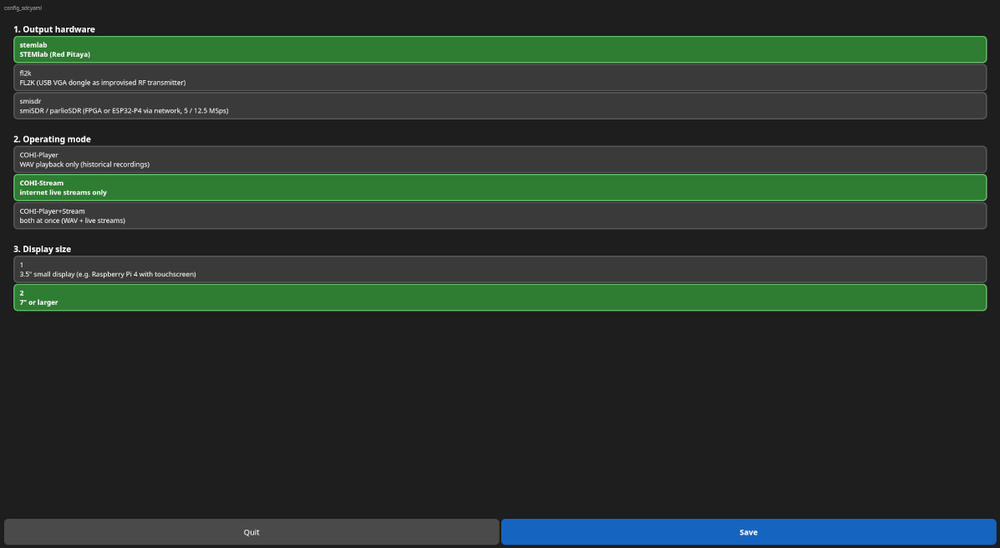

**Terminal version** (numbered menus, additionally lets you choose the language):

```bash
python3 cohi_config_setup.py
```

Both tools accept the path to a different configuration file as an optional argument. If a live stream mode is selected together with FL2K, the upconverter is set to `cpp` (the terminal version asks first).

### 5.2 Settings in `config_sdr.yaml`

**General**

| Key | Values | Meaning |
|---|---|---|
| `language` | `en` / `de` / `auto` | Language of the user interface, see 5.3 |
| `hwconfig` | `stemlab` / `fl2k` / `smisdr` | Output hardware |
| `program_variant` | `COHI-Player` / `COHI-Stream` / `COHI-Player+Stream` | Program mode |
| `display_variant` | `1` / `2` | `1` = 3.5" display (480×320), `2` = 7" or larger |
| `filename`, `filename2`, `filename3`, … | directory | Directories with the WAV recordings (any number; subdirectories are included, see 2.1) |
| `shutdown` | `true` / `false` | `true`: the shutdown button also shuts down the computer |
| `autovol` | number, typically `1.0` | Modulation level; only change it for unusually quiet or loud recordings |
| `agc_interval` | `0` or seconds | `0`: automatic level adjustment once at the start of each track. Values > 0 only write additional level measurements to the log file |
| `log_mode` | `session` / `append` / `off` | Log file `system_log.log`: new at every start / keeps growing / no log file |

**STEMlab**

| Key | Meaning |
|---|---|
| `address` | IP address of the STEMlab. Empty or `0.0.0.0` = search automatically on the local network; the address found is saved here |
| `stemlab_live_lo_freq` | Only for COHI-Stream: centre (LO) frequency in Hz, e.g. `1125000` |
| `stemlab_live_sample_rate` | Only for COHI-Stream: sample rate in Hz. **Recommended: `1250000`** – covers the whole medium wave band; higher rates can cause crackling |
| `stemlab_live_upconverter_path` | Optional path to `cohi_stemlab_live_upconverter` |

In COHI-Player+Stream the LO frequency and sample rate are taken from the WAV recording; the two `stemlab_live_…` entries are then ignored.

**FL2K**

| Key | Meaning |
|---|---|
| `fl2k_upconverter` | `cpp` (recommended, required for live streams), `native` (Python, sufficient on a Pi 5) or `ffmpeg` (high CPU load, mainly for Windows) |
| `fl2k_path`, `ffmpeg_path` | Optional paths to `fl2k_file` and `ffmpeg` (mainly for Windows) |
| `fl2k_cpp_upconverter_path` | Optional path to `cohi_native_upconverter` |

**smiSDR / parlioSDR**

| Key | Meaning |
|---|---|
| `smisdr_address` | IP address or host name of the device (default `127.0.0.1`) |
| `smisdr_data_port`, `smisdr_control_port` | TCP ports for the sample stream (default `1234`) and the width/rate commands (default `5000`). `smisdr_control_port: 0` switches the control port off, see 5.5 |
| `smisdr_sample_rate` | Output sample rate in MSps: `5`, `10`, `12.5` or `auto` (the lowest of these rates at which the recording fits) |
| `smisdr_format` | `8` = 8 bit native (int8), `816` = 8 bit values in 16 bit words (int16, little endian), `10` / `12` / `14` = DAC with 10 / 12 / 14 bit as int16 (little endian, full scale ±511 / ±2047 / ±8191), see 5.5 |
| `smisdr_offset` | Only with `smisdr_format: 8`: `true` = unsigned 8 bit (DC offset +128), `false` = signed (default) |
| `fl2k_cpp_upconverter_path` | Optional path to `cohi_native_upconverter` (is used for smisdr as well) |

**Live streams and debugging**

| Key | Meaning |
|---|---|
| `live_stations_file` | Station list for COHI-Stream, see 5.4 |
| `live_control_port` | UDP port (default `8888`, `0` = off) for remote control of the field strength of each live station, see 5.6 |
| `live_sferics_port` | UDP port (default `8889`, `0` = off) for the sferics / lightning simulation, see 5.6 |
| `debug_spectrum_window`, `debug_timedomain_window` | `true` opens additional windows with spectrum/waterfall and waveform of the output signal. Only with `display_variant: 2`; requires `pyqtgraph` |

The debug option is only working at Raspberry Pi OS / Linux.

Changes to `config_sdr.yaml` take effect after restarting the program.

### 5.3 Language

```yaml
language: en     # en = English, de = German, auto = follow the system language
```

With `auto`, a German system language selects German, every other language English. The log file is always written in English.

### 5.4 Station list for COHI-Stream

The stations are stored in a CSV file (semicolon-separated, UTF-8). The column headers must be written exactly as shown (in German):

```csv
Frequenz;Bandbreite;Programmname;URL
558.0 kHz;4.5 kHz;Station A;https://example.com/stream-a.mp3
711.0 kHz;4.5 kHz;Station B;https://example.com/stream-b.m3u
```

| Column | Meaning |
|---|---|
| `Frequenz` | Carrier frequency with unit (`Hz`, `kHz` or `MHz`; decimal point or comma) |
| `Bandbreite` | Audio bandwidth with unit, e.g. `4.5 kHz` |
| `Programmname` | Name shown in the program |
| `URL` | Address of the stream (direct stream or M3U playlist) |

An example list with 31 working internet radio stations (many of them with music of the 1920s–1960s) is included as **`Web-Streams.csv`** and is preset in `config_sdr.yaml`. Internet streams change their addresses from time to time – if a station stays silent, check its URL.

A matching location file for the propagation simulator (`Web-Streams-Locations.csv`) is described in 2.5.

The list can be loaded, edited and saved directly in the program (buttons *Load*, *Save*, *Edit*). The program remembers the last list used and loads it again at the next start; `live_stations_file` is only used if no list has been loaded before. Faulty lines are skipped and noted in the log file.

### 5.5 smiSDR / parlioSDR (and fl2k_tcp)

With `hwconfig: smisdr` COHI-Player feeds a [smiSDR / parlioSDR](https://github.com/radiolab81/smisdr) with ready-made RF samples, using the same network interface as the COHIRADIAStreamer (classic mode, not the I/Q in-band mode):

1. For every recording the player sends `width 8` (or `width 16` for `smisdr_format: 816`, `10`, `12` and `14`) and `rate 5.0`, `rate 10.0` or `rate 12.5` to the **control port** (TCP, one short connection per command).
2. Then it opens one connection to the **data port** and streams the RF samples in real time.

The digital upconversion is done by the same C++ tool as for FL2K (`cohi_native_upconverter`, compile with `make`), which is started with a target rate of exactly 5, 10 or 12.5 MHz. Without the new option `--output-bits` the tool behaves exactly as before (8 bit, byte-identical output, also for FL2K); only for `smisdr_format: 10`, `12` and `14` the player adds `--output-bits 10|12|14`. All three program modes (COHI-Player, COHI-Stream, COHI-Player+Stream) are supported; on Windows only COHI-Player.

Which rate is possible depends on the recording: the highest signal frequency (centre frequency + sample rate / 2) must lie below 95 % of the Nyquist frequency of the output rate, i.e. below approx. 2.4 MHz at 5 MSps, 4.75 MHz at 10 MSps and 5.9 MHz at 12.5 MSps. Longwave and mediumwave recordings need only 5 MSps. If the recording does not fit the configured rate, an error is shown; `smisdr_sample_rate: auto` chooses the rate automatically.

**Hardware with a fixed configuration:** if the target hardware is already set to its rate and width and has no (or no needed) control port, set `smisdr_control_port: 0`. The player then starts without touching port 5000 - no width/rate commands are sent and the control port is not tested at start. Because nothing can be set on the device any more, `smisdr_sample_rate` must then be given explicitly (not `auto`) and, together with `smisdr_format`, has to match the hardware; recordings that do not fit the fixed rate are reported as an error.

**Sample formats and DAC width:**

| `smisdr_format` | Command `width` | Data on the data port |
|---|---|---|
| `8` | 8 | int8, ±127 (optionally unsigned with `smisdr_offset: true`) |
| `816` | 16 | int16 little endian, values in the 8 bit range (±127) |
| `10` / `12` / `14` | 16 | int16 little endian, full scale ±511 / ±2047 / ±8191 |

With `10`, `12` and `14`, `cohi_native_upconverter --output-bits N` scales the already existing mixer result to the larger full scale. At the same signal level the waveform is therefore identical to the 8 bit output (the 8 bit output equals the N bit output shifted right), only the quantisation is finer. The debug windows always receive an 8 bit copy.

Notes on the wide formats:

- **Data rate:** two bytes per sample (also for `816`), i.e. 10 / 20 / 25 MByte/s (80 / 160 / 200 Mbit/s) at 5 / 10 / 12.5 MSps. Fast Ethernet (100 Mbit/s) is only sufficient at 5 MSps; at 10 and 12.5 MSps a Gigabit connection is required.
- **Resolution of the signal:** measurements of the existing DSP chain (interpolation, FIR filter, mixer) with a 1 MHz test carrier at 5 MSps showed an SNR of approx. 59 dB (8 bit), 64 dB (10 bit) and 65 dB (12 and 14 bit) in a 200 kHz band around the carrier, and a spurious-free range of approx. 70 dB. Beyond 10 bit the output quantisation therefore is no longer the limiting factor; the remaining limit comes from the existing DSP chain (most likely the interpolation/filter structure - a finer sine table made no difference in a test). 12 and 14 bit DACs can be driven with their full word width, but the signal does not get 12 or 14 bit of dynamic range from that.

**Current limitation:** the **I/Q in-band signaling** of the smiSDR / parlioSDR gateware (16 bit with in-band signaling, where the digital upconversion is done in the FPGA and only the I/Q baseband is transmitted) is **not implemented yet**. COHI-Player always sends ready-made RF samples (classic mode).

**fl2k_tcp as a “fake” smiSDR/parlioSDR**: While the COHI Player's pure fl2k mode uses the fl2k_file playback process, a remote or local fl2k_tcp process from the osmo-fl2k package can be used as a “fake” smiSDR/parlioSDR for testing purpose. All methods using raw RF samples over TCP/IP.

To do this, set the output hardware to smisdr in the config_sdr.yaml file. 

```bash
hwconfig: smisdr
```

For a local fl2k_tcp process, leave the IP address set to localhost (127.0.0.1); otherwise, make changes here:

```bash
# IP address (or host name) of the smiSDR / parlioSDR:
smisdr_address: 127.0.0.1

```

An fl2k_tcp process is not normally configured dynamically via port 5000, which is why smisdr_control_port is set to 0. Select a sample rate of 10 MSps and an 8-bit (native) format.


```bash
# TCP ports of the device (data = sample stream, control = width/rate).
# smisdr_control_port: 0 switches the control port OFF - for target hardware
# that is already fixed to its rate and width. Then nothing is sent to it,
# smisdr_sample_rate and smisdr_format must match the hardware, and
# smisdr_sample_rate must not be "auto".
smisdr_data_port: 1234
smisdr_control_port: 0

# Output sample rate in MSps - exactly one of:
#   5    - 5 MSps (all of LW/MW and the lower part of SW)
#   10   - 10 MSps (up to approx. 4.7 MHz)
#   12.5 - 12.5 MSps (needed above approx. 4.7 MHz, e.g. SW bands)
#   auto - the lowest of these rates at which the recording fits
#          (not possible without control port)
smisdr_sample_rate: 10

# Sample format on the data port:
#   8   - 8 bit native (int8)
#   816 - 8 bit values in 16 bit words (int16, little endian)
smisdr_format: 8
```

Start the fl2k_tcp process and socat before (!) establishing the connection with COHI-Player-Universal

```bash
socat -u TCP4-LISTEN:1234,reuseaddr TCP4-LISTEN:1235,reuseaddr
sudo fl2k_tcp -s 10000000 -p 1235

```

### 5.6 Remote control of the station field strength (AMWaveSynth protocol)

In COHI-Stream and COHI-Player+Stream the field strength of every live station can be changed in real time over the network, using the same protocol as [AMWaveSynth](https://github.com/radiolab81/AMWaveSynthPropagationSimulator). This allows, e.g., the AMWaveSynthPropagationSimulator to simulate band openings and closings around sunrise/sunset.

- The C++ upconverter listens on the UDP port `live_control_port` (default `8888`, all network interfaces; `0` switches it off).
- One text datagram per command: `FREQ_HZ:GAIN`, e.g. `603000:0.35`.
- The station is identified by its carrier frequency in Hz (tolerance < 1 Hz, as in the station list; `603.0 kHz` = `603000`). Frequencies that match no station are ignored.
- `GAIN` scales carrier and modulation of the station together: `1.0` = unchanged (start value), `0` = station silent, negative values are treated as `0`.
- Works with `stemlab`, `fl2k` (upconverter `cpp`) and `smisdr`.

Test from a shell:

```bash
echo -n "603000:0.3" | nc -u -w0 127.0.0.1 8888
```

**Sferics / lightning simulation** (`live_sferics_port`, default `8889`, `0` = off): one datagram `AMPLITUDE:DURATION_MS` per lightning, e.g. `800:12.5`. A noise burst with an exponentially decaying envelope (falling to 1 % after `DURATION_MS`) is added to the RF signal. `AMPLITUDE` is relative to a carrier with gain 1.0 (`AMPLITUDE/128` = peak noise level), as in AMWaveSynth; very high values are clipped by the DAC width. Active only while live stations are running. With STEMlab the noise is generated as complex noise inside the transmitted band, so the same value is not exactly the same level as with FL2K / smiSDR - adjust the amplitude by ear.

```bash
echo -n "800:12.5" | nc -u -w0 127.0.0.1 8889
```

Note: the values are held in the running upconverter process only. It is restarted when the station list is changed (and in COHI-Player+Stream when the recording / sample rate changes); the gains then return to `1.0` until the next command, so the simulator should repeat its values periodically. Recompile the tools with `make` after updating.

---

## 6. Usage

### 6.1 Starting the program

```bash
cd ~/cohi-player
python3 cohi_player_main.py
```

The program connects to the output hardware (with STEMlab: searches for it on the network if necessary), scans the WAV directories and starts the output. The status line shows the connection state; details are written to `system_log.log`.

### 6.2 COHI-Player

- **WAV file list** (only with `display_variant: 2`): all recordings found, with duration and source (`(1)` = `filename`, `(2)` = `filename2`, …). Clicking a line starts that recording. On the 3.5" display the name of the current recording is shown instead.
- **Previous WAV / Next WAV / Restart:** change the recording or start it again from the beginning.
- **Pause / Continue:** interrupt and resume playback.
- **Time slider:** jump to any position within the recording.
- **Shutdown / Quit:** ends the program after a confirmation prompt. With STEMlab the button is labelled *Shutdown* and also shuts down the STEMlab; with `shutdown: true` the computer is shut down as well.

### 6.3 COHI-Stream

- The table shows all stations of the station list with frequency, bandwidth and a status indicator (green = stream is running, red = no data).
- **Load / Save:** open another station list or save the current one.
- **Edit** (or double-tap a line): opens the station editor to add, modify or delete a station. Changes take effect immediately.
- When the program is closed with unsaved changes, it asks whether they should be saved.

### 6.4 COHI-Player+Stream

Combines the controls of 6.2 and 6.3. The **ON/OFF** switch mutes or unmutes all live stream carriers without interrupting the WAV playback. On the 3.5" display, the arrow buttons (▶ / ◀) switch between the player half and the stream half of the window.


## 7. WAV file format

COHI-Player replays I/Q recordings (16-bit, stereo = I and Q) with an SDR header:

- **"auxi"** – the format of SDRuno and other SDR programs. Centre frequency and sample rate are taken from the header. Long recordings can be split into several files that are linked via the header entry "nextfilename".
- **"rcvr"** – an alternative SDR header format.

The sample rate of the recording must be supported by the output hardware; for STEMlab these are 20, 50, 100, 250, 500, 1250 and 2500 kHz. Please also note the file naming rule in section 2.1 (`_0.wav`).

---

## 8. Troubleshooting

| Problem | Cause / solution |
|---|---|
| The C++ tool crashes immediately or the program reports a crash (e.g. SIGILL) | The tool was compiled on a different Raspberry Pi model. Run `make clean && make` on this device. |
| "C++ tool not found" | The C++ tools have not been compiled yet: run `make` in the program directory. |
| No WAV files are found | File names must end with `_0.wav` (lower case on Linux); check `filename`, `filename2`, … in `config_sdr.yaml`. |
| Crackling with STEMlab in COHI-Stream | Use `stemlab_live_sample_rate: 1250000` instead of `2500000`. |
| smiSDR/parlioSDR is not reachable | Check `smisdr_address` and the ports in `config_sdr.yaml` and that the device is running; the control port is tested at program start. |
| "recording does not fit the smisdr output rate" | Set a higher `smisdr_sample_rate` or `auto` (see 5.5). |
| STEMlab is not found | Check the network connection and the STEMlab firmware; alternatively enter the IP address in `address`. |
| A live station stays silent (red status) | The stream address may have changed – check the URL in the station list. |
| Standard buttons (Yes/No) remain English with `language: de` | Install `qttranslations5-l10n`. |
| High CPU load with FL2K | Use `fl2k_upconverter: cpp`. |

For any problem, the log file `system_log.log` in the program directory is the first place to look (with `log_mode: append` it covers several program runs).

---

## 9. Author and license

**Author:** Claus Peter Gallenmiller – cpg-radio@gmx.de

COHI-Player-Universal is free software: you can redistribute it and/or modify it under the terms of the **GNU General Public License, version 3** as published by the Free Software Foundation. It is distributed in the hope that it will be useful, but **without any warranty**; see the file [LICENSE](LICENSE) for details.

This project uses, among others: [PyQt5](https://www.riverbankcomputing.com/software/pyqt/), [NumPy](https://numpy.org/), [PyYAML](https://pyyaml.org/), [Paramiko](https://www.paramiko.org/), [python-zeroconf](https://github.com/python-zeroconf/python-zeroconf), [psutil](https://github.com/giampaolo/psutil), [FFmpeg](https://ffmpeg.org/) and [osmo-fl2k](https://osmocom.org/projects/osmo-fl2k).
