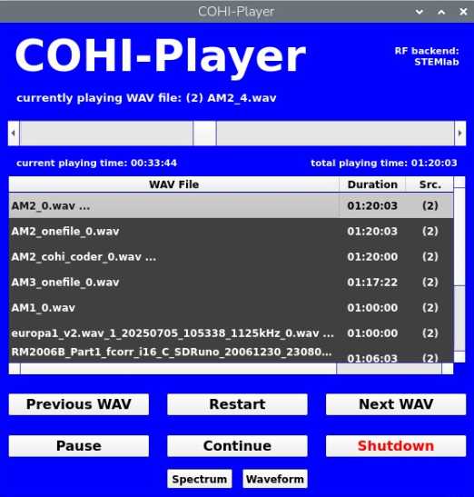
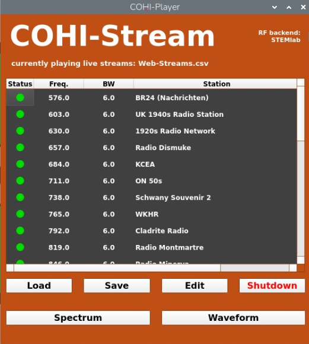
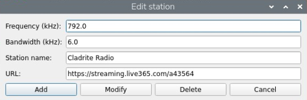
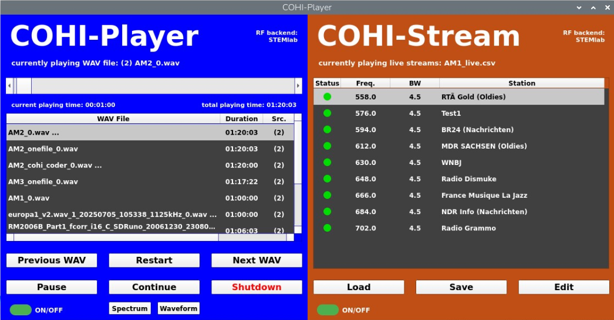
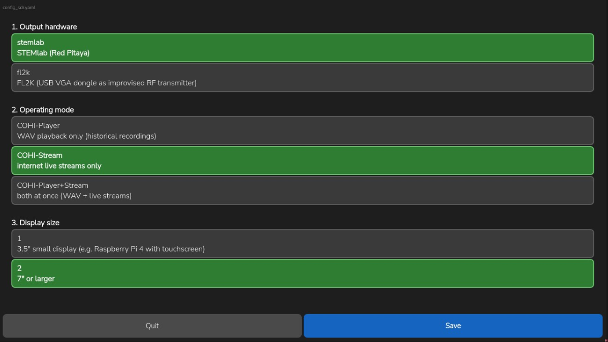

# COHI-Player-Universal

**Version 1.0.0** · Author: Claus Peter Gallenmiller · License: [GPL-3.0](LICENSE)

COHI-Player turns a Raspberry Pi or PC into a small "broadcast station" for vintage radios. It replays recordings of complete AM broadcast bands and/or current internet radio streams on several freely selectable carrier frequencies at the same time, so that an old receiver can be tuned across the dial just like in its day. 

COHI-Player is part of the COHIRADIA project. Detailed information for installation, hardware setup and an archive with many recordings from 2006 on can be found on [COHIRADIA](https://www.cohiradia.org/).

The radio frequency signal is generated either by an **STEMlab / Red Pitaya** board or by an inexpensive **FL2K USB-to-VGA dongle** (osmo-fl2k).

The COHI-Player-Universal does not need any manual interaction for loading or starting the playback of a spectrum file. It starts automatically to play all spectrum wav files stored on an USB stick or any internal directory. Thus, it is an ideal source to simulate antenna signals for historic radio receivers in large collections or museums.

> **Important – please read before use:** The output of this software is a real RF signal in the medium wave band. Transmitting on these frequencies without a licence is illegal in most countries and can disturb other services. Connect the output to the receiver **by cable** (e.g. via a suitable attenuator to the antenna input) or use a coupling loop with negligible radiation. You are responsible for operating the setup in compliance with your local regulations.

---

## 1. Overview

| Program | Purpose |
|---|---|
| **COHI-Player** | Replays SDR band recordings (I/Q WAV files) – e.g. historical recordings of the complete medium wave band |
| **COHI-Stream** | Feeds current internet radio streams (MP3/AAC/M3U) as AM carriers on user-defined frequencies |
| **COHI-Player+Stream** | Both at once: a band recording plus additional live stream carriers |


The three player modes share one program (`cohi_player_main.py`); the mode is selected in `config_sdr.yaml` (`program_variant`). 

The user interface is available in **English** and **German** (`language` in `config_sdr.yaml`).

---

## 2. Program modes

### 2.1 COHI-Player

Replays I/Q WAV recordings in the SDR formats "auxi" (SDRuno, including chained files) and "rcvr". Several recording directories can be configured; the player steps through all recordings found there.



> **File naming – important:** COHI-Player only finds recordings whose file name ends with **`_0.wav`** (e.g. `MW_Berlin_1936_0.wav`). All other WAV files are ignored.
>
> - The configured directories are searched **including all subdirectories**; the recordings are played in alphabetical order.
> - On Linux the ending is case-sensitive: `_0.WAV` is **not** found.
> - Long recordings that are split into several files (`…_1.wav`, `…_2.wav`, …) are linked via the "nextfilename" entry in the WAV header. Only the first file (`_0.wav`) is listed; the following parts are played automatically.

### 2.2 COHI-Stream

Plays a list of internet radio stations simultaneously, each on its own carrier frequency and with its own audio bandwidth. The station list can be edited directly in the program.





### 2.3 COHI-Player+Stream

Combines both: a band recording plus live stream carriers. On the small 3.5" display (480×320) the two halves of the window are switched with the arrow buttons (▶ / ◀) in the status line.



### 2.4 Which mode works with which output hardware

| Output (`hwconfig`) | Upconverter (`fl2k_upconverter`) | COHI-Player | COHI-Stream | COHI-Player+Stream |
|---|---|:-:|:-:|:-:|
| `stemlab` | – | ✔ | ✔ | ✔ |
| `fl2k` | `cpp` (compiled C++ tool, recommended) | ✔ | ✔ | ✔ |
| `fl2k` | `native` (Python/NumPy) | ✔ | – | – |
| `fl2k` | `ffmpeg` | ✔ | – | – |

---

## 3. Requirements

### 3.1 Hardware

- **Raspberry Pi 4** (recommended for COHI-Player) or **Raspberry Pi 5** (recommended for COHI-Player+Stream; it also runs on a Pi 4)
- Display: 3.5" touch display with 480×320 pixels (`display_variant: 1`) or 7" and larger (`display_variant: 2`)
- RF output, one of:
  - **STEMlab 125-14 / Red Pitaya** with the COHI STEMlab firmware image (see 4.4), connected via Ethernet
  - **FL2K USB-to-VGA dongle** (chip FL2000), used with osmo-fl2k
- Internet connection (only for COHI-Stream / COHI-Player+Stream). It is stronly recommended to use a wired LAN connection to avoid dropouts in the sound signal.

### 3.2 Operating systems

| | Raspberry Pi OS / Linux | Windows |
|---|:-:|:-:|
| COHI-Player with STEMlab | ✔ | ✔ |
| COHI-Player with FL2K (`ffmpeg` or `native`) | ✔ | ✔ |
| COHI-Player with FL2K (`cpp`) | ✔ | – |
| COHI-Stream, COHI-Player+Stream | ✔ | – |
| Configuration tools | ✔ | ✔ |

The live stream modes need the compiled C++ tools; a Windows build of these tools is not provided.

### 3.3 Performance depending om HW

| Program variant | Raspberry Pi 4 | Raspberry Pi 5 |
|---|:-:|:-:|
| COHI-Player with STEMlab | ✔ | ✔ |
| COHI-Player with FL2K (`ffmpeg` or `native`) | not possible | ✔ |
| COHI-Player with FL2K (`cpp`) | ✔ | ✔ |
| COHI-Stream with STEMlab | > 25 live streams | > 50 live streams |
| COHI-Stream with FL2K | < 14 live streamns | > 40 live streams |
| COHI-Player+Stream with STEMlab | WAV + > 25 live streams | WAV + > 50 live streams |
| COHI-Player+Stream with FL2K | not possible | WAV + > 40 live streams |

Estimations, the real achievable capacity may vary on stream data rate and stability and Raspberry Pi memory size.

---

## 4. Installation

### 4.1 Raspberry Pi OS

Download the release (or clone the repository) into a directory of your choice, e.g. `~/cohi-player`, and change into it.

System packages:

```bash
sudo apt update
sudo apt install python3-pyqt5 qttranslations5-l10n ffmpeg build-essential osmo-fl2k
```

- `qttranslations5-l10n` is only needed for German standard buttons (Yes/No, file dialogs).
- `osmo-fl2k` is only needed for the FL2K dongle.

Python packages:

```bash
pip install -r requirements.txt --break-system-packages
```

Optional, only for the debug windows (spectrum/waterfall and waveform, `display_variant: 2`):

```bash
pip install pyqtgraph --break-system-packages
```

### 4.2 Compiling the C++ tools

The C++ tools are required for COHI-Stream, COHI-Player+Stream and the FL2K upconverter `cpp`:

```bash
make
```

> **Always compile on the target device.** The tools are optimised for the CPU they are built on (`-march=native`). A binary compiled on a Raspberry Pi 5 crashes silently on a Raspberry Pi 4. If you move the installation to another Pi model, run `make clean && make` there.

### 4.3 Windows

1. Install Python 3 from [python.org](https://www.python.org/) and run `pip install -r requirements.txt` in the program directory.
2. **For FL2K:** install the FL2K driver and the Windows build of osmo-fl2k (`fl2k_file.exe`), and download a Windows build of ffmpeg. Enter both paths in `config_sdr.yaml` (`fl2k_path`, `ffmpeg_path`).
3. Set `fl2k_upconverter` to `ffmpeg` or `native` (the `cpp` tool is not available on Windows).

Note: with `shutdown: true` in `config_sdr.yaml` the program also shuts down the **Windows PC** when it is closed via the shutdown button.

### 4.4 Preparing the STEMlab / Red Pitaya

The STEMlab needs a special firmware image. Download the image and follow its installation guide:

- Firmware image: **T[STEMlab125 COHIRADIA V1.0](https://cohiradia.radiomuseum.org/download/software/cohiradia_STEMLAB125_v1.0.img)**
- Installation guide: **[COHIRADIA pages](https://www.cohiradia.org/de/docs/getting_started/installation/raspberry-pi-stemlab-linux-cohi-player-mini)**

The STEMlab is found automatically on the local network (leave `address` empty or set it to `0.0.0.0`), or its IP address can be entered in `config_sdr.yaml`.

---

## 5. Configuration

All settings are stored in **`config_sdr.yaml`** in the program directory. Every entry is explained by comments in the file itself; this chapter gives an overview.

> Always start the programs **from the program directory** (e.g. `cd ~/cohi-player`), because `config_sdr.yaml` is read from the current working directory.

### 5.1 Quick setup with the configuration tools

The three basic settings – output hardware, program mode and display size – are most easily set with one of the two configuration tools. Both change only these entries and keep all comments in the file; a backup of the previous version is saved as `config_sdr.yaml.bak`.

**Graphical version** (touch-friendly, also suitable for the 3.5" display):

```bash
python3 cohi_config_gui.py
```



**Terminal version** (numbered menus, additionally lets you choose the language):

```bash
python3 cohi_config_setup.py
```

Both tools accept the path to a different configuration file as an optional argument. If a live stream mode is selected together with FL2K, the upconverter is set to `cpp` (the terminal version asks first).

### 5.2 Settings in `config_sdr.yaml`

**General**

| Key | Values | Meaning |
|---|---|---|
| `language` | `en` / `de` / `auto` | Language of the user interface, see 5.3 |
| `hwconfig` | `stemlab` / `fl2k` | Output hardware |
| `program_variant` | `COHI-Player` / `COHI-Stream` / `COHI-Player+Stream` | Program mode |
| `display_variant` | `1` / `2` | `1` = 3.5" display (480×320), `2` = 7" or larger |
| `filename`, `filename2`, `filename3`, … | directory | Directories with the WAV recordings (any number; subdirectories are included, see 2.1) |
| `shutdown` | `true` / `false` | `true`: the shutdown button also shuts down the computer |
| `autovol` | number, typically `1.0` | Modulation level; only change it for unusually quiet or loud recordings |
| `agc_interval` | `0` or seconds | `0`: automatic level adjustment once at the start of each track. Values > 0 only write additional level measurements to the log file |
| `log_mode` | `session` / `append` / `off` | Log file `system_log.log`: new at every start / keeps growing / no log file |

**STEMlab**

| Key | Meaning |
|---|---|
| `address` | IP address of the STEMlab. Empty or `0.0.0.0` = search automatically on the local network; the address found is saved here |
| `stemlab_live_lo_freq` | Only for COHI-Stream: centre (LO) frequency in Hz, e.g. `1125000` |
| `stemlab_live_sample_rate` | Only for COHI-Stream: sample rate in Hz. **Recommended: `1250000`** – covers the whole medium wave band; higher rates can cause crackling |
| `stemlab_live_upconverter_path` | Optional path to `cohi_stemlab_live_upconverter` |

In COHI-Player+Stream the LO frequency and sample rate are taken from the WAV recording; the two `stemlab_live_…` entries are then ignored.

**FL2K**

| Key | Meaning |
|---|---|
| `fl2k_upconverter` | `cpp` (recommended, required for live streams), `native` (Python, sufficient on a Pi 5) or `ffmpeg` (high CPU load, mainly for Windows) |
| `fl2k_path`, `ffmpeg_path` | Optional paths to `fl2k_file` and `ffmpeg` (mainly for Windows) |
| `fl2k_cpp_upconverter_path` | Optional path to `cohi_native_upconverter` |

**Live streams and debugging**

| Key | Meaning |
|---|---|
| `live_stations_file` | Station list for COHI-Stream, see 5.4 |
| `debug_spectrum_window`, `debug_timedomain_window` | `true` opens additional windows with spectrum/waterfall and waveform of the output signal. Only with `display_variant: 2`; requires `pyqtgraph` |

Changes to `config_sdr.yaml` take effect after restarting the program.

### 5.3 Language

```yaml
language: en     # en = English, de = German, auto = follow the system language
```

With `auto`, a German system language selects German, every other language English. The log file is always written in English.

### 5.4 Station list for COHI-Stream

The stations are stored in a CSV file (semicolon-separated, UTF-8). The column headers must be written exactly as shown (in German):

```csv
Frequenz;Bandbreite;Programmname;URL
558.0 kHz;4.5 kHz;Station A;https://example.com/stream-a.mp3
711.0 kHz;4.5 kHz;Station B;https://example.com/stream-b.m3u
```

| Column | Meaning |
|---|---|
| `Frequenz` | Carrier frequency with unit (`Hz`, `kHz` or `MHz`; decimal point or comma) |
| `Bandbreite` | Audio bandwidth with unit, e.g. `4.5 kHz` |
| `Programmname` | Name shown in the program |
| `URL` | Address of the stream (direct stream or M3U playlist) |

An example list with 31 working internet radio stations (many of them with music of the 1920s–1960s) is included as **`Web-Streams.csv`** and is preset in `config_sdr.yaml`. Internet streams change their addresses from time to time – if a station stays silent, check its URL.

The list can be loaded, edited and saved directly in the program (buttons *Load*, *Save*, *Edit*). The program remembers the last list used and loads it again at the next start; `live_stations_file` is only used if no list has been loaded before. Faulty lines are skipped and noted in the log file.

---

## 6. Usage

### 6.1 Starting the program

```bash
cd ~/cohi-player
python3 cohi_player_main.py
```

The program connects to the output hardware (with STEMlab: searches for it on the network if necessary), scans the WAV directories and starts the output. The status line shows the connection state; details are written to `system_log.log`.

### 6.2 COHI-Player

- **WAV file list** (only with `display_variant: 2`): all recordings found, with duration and source (`(1)` = `filename`, `(2)` = `filename2`, …). Clicking a line starts that recording. On the 3.5" display the name of the current recording is shown instead.
- **Previous WAV / Next WAV / Restart:** change the recording or start it again from the beginning.
- **Pause / Continue:** interrupt and resume playback.
- **Time slider:** jump to any position within the recording.
- **Shutdown / Quit:** ends the program after a confirmation prompt. With STEMlab the button is labelled *Shutdown* and also shuts down the STEMlab; with `shutdown: true` the computer is shut down as well.

### 6.3 COHI-Stream

- The table shows all stations of the station list with frequency, bandwidth and a status indicator (green = stream is running, red = no data).
- **Load / Save:** open another station list or save the current one.
- **Edit** (or double-tap a line): opens the station editor to add, modify or delete a station. Changes take effect immediately.
- When the program is closed with unsaved changes, it asks whether they should be saved.

### 6.4 COHI-Player+Stream

Combines the controls of 6.2 and 6.3. The **ON/OFF** switch mutes or unmutes all live stream carriers without interrupting the WAV playback. On the 3.5" display, the arrow buttons (▶ / ◀) switch between the player half and the stream half of the window.


## 7. WAV file format

COHI-Player replays I/Q recordings (16-bit, stereo = I and Q) with an SDR header:

- **"auxi"** – the format of SDRuno and other SDR programs. Centre frequency and sample rate are taken from the header. Long recordings can be split into several files that are linked via the header entry "nextfilename".
- **"rcvr"** – an alternative SDR header format.

The sample rate of the recording must be supported by the output hardware; for STEMlab these are 20, 50, 100, 250, 500, 1250 and 2500 kHz. Please also note the file naming rule in section 2.1 (`_0.wav`).

---

## 8. Troubleshooting

| Problem | Cause / solution |
|---|---|
| The C++ tool crashes immediately or the program reports a crash (e.g. SIGILL) | The tool was compiled on a different Raspberry Pi model. Run `make clean && make` on this device. |
| "C++ tool not found" | The C++ tools have not been compiled yet: run `make` in the program directory. |
| No WAV files are found | File names must end with `_0.wav` (lower case on Linux); check `filename`, `filename2`, … in `config_sdr.yaml`. |
| Crackling with STEMlab in COHI-Stream | Use `stemlab_live_sample_rate: 1250000` instead of `2500000`. |
| STEMlab is not found | Check the network connection and the STEMlab firmware; alternatively enter the IP address in `address`. |
| A live station stays silent (red status) | The stream address may have changed – check the URL in the station list. |
| Standard buttons (Yes/No) remain English with `language: de` | Install `qttranslations5-l10n`. |
| High CPU load with FL2K | Use `fl2k_upconverter: cpp`. |

For any problem, the log file `system_log.log` in the program directory is the first place to look (with `log_mode: append` it covers several program runs).

---

## 9. Author and license

**Author:** Claus Peter Gallenmiller – cpg-radio@gmx.de

COHI-Player-Universal is free software: you can redistribute it and/or modify it under the terms of the **GNU General Public License, version 3** as published by the Free Software Foundation. It is distributed in the hope that it will be useful, but **without any warranty**; see the file [LICENSE](LICENSE) for details.

This project uses, among others: [PyQt5](https://www.riverbankcomputing.com/software/pyqt/), [NumPy](https://numpy.org/), [PyYAML](https://pyyaml.org/), [Paramiko](https://www.paramiko.org/), [python-zeroconf](https://github.com/python-zeroconf/python-zeroconf), [psutil](https://github.com/giampaolo/psutil), [FFmpeg](https://ffmpeg.org/) and [osmo-fl2k](https://osmocom.org/projects/osmo-fl2k).
